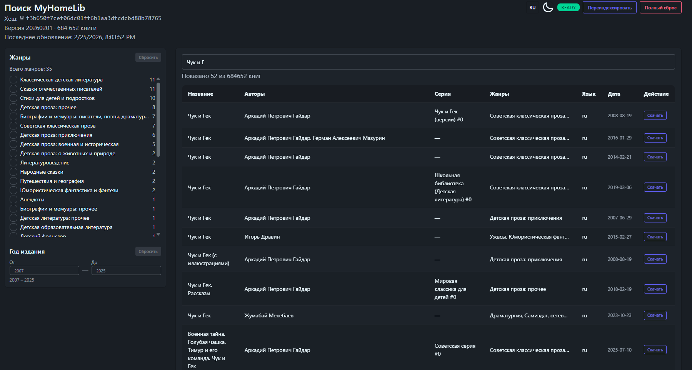

# MyHomeLib UI



Самохостируемое веб-приложение для поиска и скачивания книг с библиотеки [Флибуста](https://flibusta.is/), распространяемой через BitTorrent.

> **English version** — [see below](#myhomelib-ui--english)

---

## Как это работает

Библиотека Флибусты — один большой торрент (~500 ГБ), содержащий тысячи ZIP-архивов с книгами в формате FB2, а также INPX-файл с метаданными всех книг.

MyHomeLib **не скачивает весь торрент**. Вместо этого:

1. **При старте сервера** — скачивается только INPX-файл (~35 МБ) через [TorrServe](https://github.com/YouROK/TorrServer), парсится на сервере и загружается в [Meilisearch](https://www.meilisearch.com/). Первая индексация ~586 000 книг занимает около 5 минут; при последующих перезапусках индекс переиспользуется, если коллекция не изменилась.
2. **При поиске** — запрос уходит в Meilisearch: полнотекстовый поиск с опечатками, фасеты по жанрам, языкам и сериям. Ответ приходит за единицы миллисекунд.
3. **При скачивании** — сервер через TorrServe HTTP Range запросы читает только нужный диапазон байт из ZIP-архива (~2–2,5 ГБ каждый) и отдаёт одну книгу.

Магнет-ссылка задаётся **только через настройки сервера** (`Library__MagnetUri`). Клиент не может её подменить.

### Интерфейсы

| Адрес | Для кого |
|-------|----------|
| `/` | Vue SPA — обычный браузер на компьютере или телефоне |
| `/m` | Серверный HTML без JavaScript — читалки, e-ink, слабые устройства |
| `/opds` | OPDS 1.2 каталог — приложения-читалки с поддержкой OPDS |
| `/api` | JSON API — `search`, `author`, `series`, `book`, `status`, `genres` |

Браузеры читалок (PocketBook, Kindle, Kobo, Onyx, Boox, reMarkable) с корня автоматически перенаправляются на `/m`. Чтобы этого избежать, откройте `/?full=1`.

---

## Способы запуска

| | Способ | Когда подходит |
|---|--------|----------------|
| 🥇 | [Standalone HTML](#standalone-версия-один-html-файл) | Просто пользоваться — без сервера, без установки |
| 🥈 | [Docker Compose](#быстрый-старт-через-docker-compose) | Самохостинг на своём сервере |

---

## Быстрый старт через Docker Compose

Самый простой способ запустить всё вместе:

```bash
git clone <репозиторий>
cd homelib-ui
cp .env.example .env
```

Отредактируйте `.env` — как минимум укажите магнет-ссылку библиотеки:

```ini
LIBRARY_MAGNET_URI=magnet:?xt=urn:btih:...
LIBRARY_TITLE=Flibusta
MEILI_MASTER_KEY=не-менее-16-байт
```

```bash
docker compose up -d
```

`docker-compose.yml` поднимает три сервиса:
- **torrserve** — TorrServe, вся работа с BitTorrent
- **meilisearch** — поисковый движок, данные в томе `meili_data`
- **myhomelib** — веб-приложение на порту `5080`

Откройте в браузере: [http://localhost:5080](http://localhost:5080)

> **Первый запуск занимает около 5 минут** — скачивание INPX и построение индекса. Пока индекс строится, `/m` и `/opds` показывают прогресс и обновляются сами.

### Требования к ресурсам

| | |
|---|---|
| Диск под индекс Meilisearch | ~1,5–2 ГБ на 586 000 книг |
| RAM при индексации | ограничена `MEILI_MAX_INDEXING_MEMORY` (по умолчанию 512 МБ) |
| RAM в работе | несколько сотен МБ |

### Изменение настроек

Правьте `.env` или переменные окружения в `docker-compose.yml`. Разделитель вложенных ключей — двойное подчёркивание (`__`).

---

## Локальный запуск (без Docker)

### Предварительные требования

- [.NET 10 SDK](https://dotnet.microsoft.com/download)
- [Node.js 20+](https://nodejs.org/) — только для сборки фронтенда
- **TorrServe** — [бинарник со страницы релизов](https://github.com/YouROK/TorrServer/releases), по умолчанию слушает `http://127.0.0.1:8090`
- **Meilisearch** — проще всего поднять из compose:

  ```bash
  docker compose up -d meilisearch
  ```

  Он слушает `http://127.0.0.1:7701`. Ключ должен быть не короче 16 байт, иначе Meilisearch не стартует в режиме production.

### Сборка фронтенда

Сначала пакет-парсер, потом SPA — `MyHomeLib.Ui` подключает `inpx-parser` как локальную зависимость и без собранного `dist` не соберётся:

```bash
cd inpx-parser && npm ci && npm run build
cd ../MyHomeLib.Ui && npm ci && npm run build
```

### Запуск бэкенда

```bash
dotnet run --project MyHomeLib.Web
```

Магнет-ссылка и адреса сервисов задаются переменными окружения:

```bash
Library__MagnetUri="magnet:?xt=urn:btih:..."
Torrent__TorrServeUrl="http://127.0.0.1:8090"
Meili__Url="http://127.0.0.1:7701"
Meili__ApiKey="ваш-ключ"
```

> Используйте `127.0.0.1`, а не `localhost`: при наличии VPN-адаптеров подключение к `localhost` может стоить ~200 мс на каждый запрос из-за неудачной попытки IPv6.

Для разработки удобно указать локальный INPX-файл и не ждать TorrServe:

```bash
Library__InpxPath="D:\books\flibusta_fb2_local.inpx"
```

### Полная сборка вместе с SPA

```bash
dotnet publish MyHomeLib.Web -c Release -o ./publish
```

Цель `BuildClientUi` сама соберёт SPA и положит её в `wwwroot`. Чтобы этого не делать, добавьте `-p:BuildClientApp=false`.

### Разработка фронтенда с hot-reload

```bash
cd MyHomeLib.Ui
npm run dev
```

---

## Конфигурация

### Секция `Library`

| Ключ | Обязательно | По умолчанию | Описание |
|------|-------------|--------------|----------|
| `MagnetUri` | Да | — | Магнет-ссылка библиотеки. Без неё книги не скачиваются |
| `InpxPath` | Нет | — | Локальный `.inpx`: индексация без обращения к TorrServe (для разработки) |
| `Title` | Нет | `MyHomeLib` | Название коллекции, если его нет в самом INPX |
| `ForceReindex` | Нет | `false` | Переиндексировать при старте, даже если ничего не изменилось |
| `IndexBatchSize` | Нет | `10000` | Размер пачки документов при загрузке в Meilisearch |

### Секция `Meili`

| Ключ | Обязательно | По умолчанию | Описание |
|------|-------------|--------------|----------|
| `Url` | Да | `http://127.0.0.1:7700` | Адрес Meilisearch |
| `ApiKey` | Нет | — | Мастер-ключ, если Meilisearch запущен с ключом |
| `IndexUid` | Нет | `books` | Имя индекса |

### Секция `Torrent`

| Ключ | Обязательно | По умолчанию | Описание |
|------|-------------|--------------|----------|
| `TorrServeUrl` | Да | `http://127.0.0.1:8090` | Адрес TorrServe |

### Пример `appsettings.json`

```json
{
  "Library": {
    "MagnetUri": "magnet:?xt=urn:btih:...",
    "Title": "Flibusta"
  },
  "Meili": {
    "Url": "http://127.0.0.1:7700",
    "ApiKey": "",
    "IndexUid": "books"
  },
  "Torrent": {
    "TorrServeUrl": "http://127.0.0.1:8090"
  }
}
```

---

## Standalone-версия (один HTML-файл)

Если вы просто хотите пользоваться библиотекой, не поднимая собственный сервер — используйте standalone-сборку.

**🌐 Публичная ссылка:** [https://alfeg.github.io/homelib-ui/index.html](https://alfeg.github.io/homelib-ui/index.html)

Или скачайте файл:

1. Скачайте файл [`docs/index.html`](docs/index.html) — его собирает `npm run build-standalone`.
2. Откройте его в браузере (двойной клик или `file://`).
3. По умолчанию приложение подключается к публичному серверу **books.alfeg.net**.

Индекс (~685 000 книг) скачивается с публичного сервера, парсится в браузере и сохраняется в IndexedDB. Повторные открытия — мгновенные.

### Хотите использовать собственный сервер?

В форме подключения библиотеки раскройте раздел **⚙ API сервер** и введите URL вашего инстанса, например `https://my-server.example.com`. Значение сохраняется в `localStorage` браузера.

> Собственный сервер разворачивается через Docker Compose (см. выше). Библиотеку выбирает сервер через `LIBRARY_MAGNET_URI`, в браузере магнет-ссылка не вводится.

---

## Первый запуск

1. Сервер скачивает INPX (~35 МБ) через TorrServe. На холодном торренте это может занять минуту-другую.
2. INPX парсится (~700 000 строк за ~1,5 с) и загружается в Meilisearch пачками. Полная индексация ~586 000 книг — около 5 минут.
3. Пока идёт индексация, `/m` и `/opds` отдают страницу с прогрессом и сами обновляются; `/api/status` возвращает то же самое в JSON.
4. После готовности поиск отвечает за единицы миллисекунд.

**При перезапуске** индекс не строится заново: сервер сверяет содержимое коллекции и, если оно не изменилось, готов через несколько секунд.

---

## Поиск и фильтры

- **Поиск** по названию, автору, серии, языку — AND по всем словам, prefix-matching.
- **Фильтр по жанрам** — список жанров со счётчиками в левой панели.
- **Фильтр по году** — выбор диапазона годов издания. Счётчики жанров обновляются при изменении года.

---

## Скачивание книг

1. Найдите книгу в поиске.
2. Нажмите ⬇ рядом с нужной книгой — сервер стримит книгу из TorrServe напрямую в браузер.

Ничего не сохраняется на сервере.

TorrServe загружает только те фрагменты торрента, которые содержат нужную книгу. Типичное время — несколько секунд.

---

## Использование памяти

- **Сервер** (~100–200 МБ): INPX держится в памяти только во время индексации, книги на диск не сохраняются.
- **Meilisearch**: ~1,5–2 ГБ на диске под индекс 586 000 книг. Пик потребления RAM приходится на индексацию и ограничивается `MEILI_MAX_INDEXING_MEMORY`.
- **Браузер**: `/m` — единицы килобайт на страницу. SPA строит собственный индекс в IndexedDB и занимает ~300–500 МБ.

---

## Структура проекта

```
MyHomeLibServer.slnx
├── MyHomeLib.Library/   # Модель книги, парсер INPX, отпечаток коллекции (.NET)
├── MyHomeLib.Web/       # ASP.NET Core: индексация, поиск, OPDS, /m, загрузки
├── MyHomeLib.Ui/        # Vue 3 + TypeScript + Vite SPA
└── inpx-parser/         # npm-пакет: парсер INPX для браузера (используется SPA)
```

### Ключевые файлы

| Файл | Назначение |
|------|-----------|
| `MyHomeLib.Library/InpReader.cs` | Разбор строк `.inp`: разделитель `\x04`, UTF-8/CP1251, устойчив к битым полям |
| `MyHomeLib.Library/BookUid.cs` | Стабильный идентификатор книги. Id из INPX не уникальны |
| `MyHomeLib.Library/InpxSignature.cs` | Отпечаток коллекции: решает, нужна ли переиндексация |
| `MyHomeLib.Web/Services/Search/LibraryIndexerService.cs` | Загрузка INPX в Meilisearch при старте |
| `MyHomeLib.Web/Services/Search/LibrarySearchService.cs` | Единственный путь запросов для API, OPDS и `/m` |
| `MyHomeLib.Web/Services/HttpRangeStream.cs` | Seekable Stream поверх HTTP Range |
| `MyHomeLib.Web/Controllers/OpdsController.cs` | OPDS 1.2 каталог |
| `MyHomeLib.Web/Views/Thin/` | Страницы `/m` без JavaScript |
| `MyHomeLib.Ui/src/workers/searchIndex.worker.ts` | MiniSearch в Web Worker (путь SPA) |
| `Dockerfile` | Многоэтапная сборка (.NET 10 + Node.js → ASP.NET runtime, порт 8080) |
| `docker-compose.yml` | TorrServe + Meilisearch + MyHomeLib |

---

## Лицензия

[MIT](LICENSE)

---

---

# MyHomeLib UI — English

A self-hosted web application for searching and downloading books from the [Flibusta](https://flibusta.is/) e-book library distributed as a BitTorrent.

## How it works

The Flibusta library is a single large torrent (~500 GB) containing thousands of ZIP archives with FB2 books and an INPX index file with metadata for all books.

MyHomeLib **never downloads the full torrent**. Instead:

1. **On server start** — only the INPX index (~35 MB) is fetched via [TorrServe](https://github.com/YouROK/TorrServer), parsed on the server and bulk loaded into [Meilisearch](https://www.meilisearch.com/). The first build of ~586,000 books takes around five minutes; later restarts reuse the index when the collection has not changed.
2. **On search** — the query goes to Meilisearch: full-text with typo tolerance, plus facets over genres, languages and series. Responses come back in single-digit milliseconds.
3. **On download** — the server reads only the needed byte range out of a ZIP archive (~2–2.5 GB each) through TorrServe HTTP Range requests and returns the one book.

The magnet URI is set **only in server configuration** (`Library__MagnetUri`). Clients cannot supply one.

### Interfaces

| Path | Audience |
|------|----------|
| `/` | Vue SPA — a normal desktop or phone browser |
| `/m` | Server-rendered HTML with no JavaScript — e-readers, e-ink, low-power devices |
| `/opds` | OPDS 1.2 catalog — reader apps that speak OPDS |
| `/api` | JSON API — `search`, `author`, `series`, `book`, `status`, `genres` |

E-reader browsers (PocketBook, Kindle, Kobo, Onyx, Boox, reMarkable) are redirected from the site root to `/m`. Open `/?full=1` to get the SPA anyway.

---

## Standalone build (single HTML file)

The easiest way to start — no installation or server required.

**🌐 Public link:** [https://alfeg.github.io/homelib-ui/index.html](https://alfeg.github.io/homelib-ui/index.html)

Or download the file:

1. Download [`docs/index.html`](docs/index.html) — produced by `npm run build-standalone`.
2. Open it in any browser (double-click or `file://`).
3. By default it connects to the public server **books.alfeg.net**.

The index (~685 000 books) is downloaded from the public server, parsed in the browser, and cached in IndexedDB. Repeat visits are instant.

### Using your own server

On the library connection screen expand **⚙ API Server** and enter your instance URL, e.g. `https://my-server.example.com`. The value is saved in `localStorage`.

> Your server is deployed via Docker Compose (see above). The server picks the library through `LIBRARY_MAGNET_URI`; the magnet URI is never entered in the browser.

---

## Getting started

| | Option | When to use |
|---|--------|-------------|
| 🥇 | [Standalone HTML](#standalone-version-single-html-file) | Just use it — no server, no installation |
| 🥈 | [Docker Compose](#quick-start-with-docker-compose) | Self-hosting on your own server |

---

## Quick start with Docker Compose

```bash
git clone <repo>
cd homelib-ui
cp .env.example .env
```

Edit `.env` — at minimum point it at a library:

```ini
LIBRARY_MAGNET_URI=magnet:?xt=urn:btih:...
LIBRARY_TITLE=Flibusta
MEILI_MASTER_KEY=at-least-16-bytes
```

```bash
docker compose up -d
```

`docker-compose.yml` starts three services:
- **torrserve** — TorrServe, which does all the BitTorrent work
- **meilisearch** — the search engine, with data in the `meili_data` volume
- **myhomelib** — the web app on port `5080`

Open [http://localhost:5080](http://localhost:5080).

> **The first start takes about five minutes** — fetching the INPX and building the index. While that runs, `/m` and `/opds` serve a progress page that refreshes itself.

### Resource requirements

| | |
|---|---|
| Disk for the Meilisearch index | ~1.5–2 GB for 586,000 books |
| RAM while indexing | capped by `MEILI_MAX_INDEXING_MEMORY` (512 MB by default) |
| RAM when serving | a few hundred MB |

### Customising settings

Edit `.env`, or the environment variables in `docker-compose.yml`. Nested config keys use a double underscore (`__`) as the separator.

---

## Running locally (without Docker)

### Prerequisites

- [.NET 10 SDK](https://dotnet.microsoft.com/download)
- [Node.js 20+](https://nodejs.org/) — only needed to build the frontend
- **TorrServe** — grab a binary from the [releases page](https://github.com/YouROK/TorrServer/releases); it listens on `http://127.0.0.1:8090` by default
- **Meilisearch** — easiest from compose:

  ```bash
  docker compose up -d meilisearch
  ```

  It listens on `http://127.0.0.1:7701`. The master key must be at least 16 bytes or Meilisearch refuses to start in production mode.

### Build the frontend

Parser package first, then the SPA: `MyHomeLib.Ui` consumes `inpx-parser` as a local dependency and will not build without its `dist`.

```bash
cd inpx-parser && npm ci && npm run build
cd ../MyHomeLib.Ui && npm ci && npm run build
```

### Run the backend

```bash
dotnet run --project MyHomeLib.Web
```

The magnet URI and service addresses come from environment variables:

```bash
Library__MagnetUri="magnet:?xt=urn:btih:..."
Torrent__TorrServeUrl="http://127.0.0.1:8090"
Meili__Url="http://127.0.0.1:7701"
Meili__ApiKey="your-key"
```

> Prefer `127.0.0.1` over `localhost`. On a machine with VPN adapters, connecting to `localhost` can cost ~200 ms per request on a failed IPv6 attempt before falling back.

For development you can point at a local INPX file and skip TorrServe entirely:

```bash
Library__InpxPath="D:\books\flibusta_fb2_local.inpx"
```

### Full build including the SPA

```bash
dotnet publish MyHomeLib.Web -c Release -o ./publish
```

The `BuildClientUi` target builds the SPA and copies it into `wwwroot`. Pass `-p:BuildClientApp=false` to skip it.

### Frontend development with hot-reload

```bash
cd MyHomeLib.Ui
npm run dev
```

---

## Configuration

### `Library` section

| Key | Required | Default | Description |
|-----|----------|---------|-------------|
| `MagnetUri` | Yes | — | Magnet URI of the library. Without it books cannot be downloaded |
| `InpxPath` | No | — | Local `.inpx` to index without contacting TorrServe (development) |
| `Title` | No | `MyHomeLib` | Collection name, used when the INPX does not carry one |
| `ForceReindex` | No | `false` | Rebuild on startup even when nothing changed |
| `IndexBatchSize` | No | `10000` | Documents per batch when loading Meilisearch |

### `Meili` section

| Key | Required | Default | Description |
|-----|----------|---------|-------------|
| `Url` | Yes | `http://127.0.0.1:7700` | Meilisearch address |
| `ApiKey` | No | — | Master key, when Meilisearch runs with one |
| `IndexUid` | No | `books` | Index name |

### `Torrent` section

| Key | Required | Default | Description |
|-----|----------|---------|-------------|
| `TorrServeUrl` | Yes | `http://127.0.0.1:8090` | TorrServe address |

### Example `appsettings.json`

```json
{
  "Library": {
    "MagnetUri": "magnet:?xt=urn:btih:...",
    "Title": "Flibusta"
  },
  "Meili": {
    "Url": "http://127.0.0.1:7700",
    "ApiKey": "",
    "IndexUid": "books"
  },
  "Torrent": {
    "TorrServeUrl": "http://127.0.0.1:8090"
  }
}
```

---

## Memory usage

- **Server** (~100–200 MB): the INPX is held in memory only while indexing, and no book is written to disk.
- **Meilisearch**: ~1.5–2 GB on disk for an index of 586,000 books. RAM peaks during indexing and is capped by `MEILI_MAX_INDEXING_MEMORY`.
- **Browser**: `/m` costs a few kilobytes per page. The SPA builds its own index in IndexedDB and uses ~300–500 MB.

---

## Project structure

```
MyHomeLibServer.slnx
├── MyHomeLib.Library/   # Book model, INPX parser, collection fingerprint (.NET)
├── MyHomeLib.Web/       # ASP.NET Core: indexing, search, OPDS, /m, downloads
├── MyHomeLib.Ui/        # Vue 3 + TypeScript + Vite SPA
└── inpx-parser/         # npm package: browser-side INPX parser used by the SPA
```

### Key files

| File | Purpose |
|------|---------|
| `MyHomeLib.Library/InpReader.cs` | Parses `.inp` rows: `\x04` delimiter, UTF-8/CP1251, tolerant of malformed fields |
| `MyHomeLib.Library/BookUid.cs` | Stable book identifier — INPX ids are not unique |
| `MyHomeLib.Library/InpxSignature.cs` | Collection fingerprint that decides whether a reindex is needed |
| `MyHomeLib.Web/Services/Search/LibraryIndexerService.cs` | Loads the INPX into Meilisearch at startup |
| `MyHomeLib.Web/Services/Search/LibrarySearchService.cs` | The single query path behind the API, OPDS and `/m` |
| `MyHomeLib.Web/Services/HttpRangeStream.cs` | Seekable `Stream` backed by HTTP Range — lets `ZipArchive` read a remote ZIP without downloading all of it |
| `MyHomeLib.Web/Controllers/OpdsController.cs` | OPDS 1.2 catalog |
| `MyHomeLib.Web/Views/Thin/` | The no-JavaScript `/m` pages |
| `MyHomeLib.Ui/src/workers/searchIndex.worker.ts` | MiniSearch in a Web Worker (the SPA path) |
| `Dockerfile` | Multi-stage build: .NET 10 SDK + Node.js → ASP.NET runtime, port 8080 |
| `docker-compose.yml` | Starts TorrServe + Meilisearch + MyHomeLib |

---

## License

[MIT](LICENSE)
